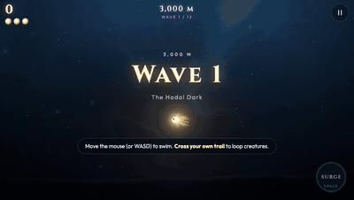

# Abyss Weaver

You are a lantern-spirit on the bottom of a drowned world. Cross your trail
to close a loop of light and catch every creature inside it. Climb from
3,000 metres to the surface through **12 waves and three bosses**, or see
how far you can go in **Endless Abyss**.

[Play Abyss Weaver on Dorothy](https://dorothy.gr/games/abyssweaver/)



## Run locally

Use Node.js 22.12 or newer.

```sh
npm ci
npm run dev
```

Open the local address printed by Vite, normally `http://127.0.0.1:5173/`.
For a static build, run `npm run build` and `npm run preview`. The preview is
available at `http://127.0.0.1:4173/`.

## How to play

| Input | Swim | Surge | Pause |
| --- | --- | --- | --- |
| Keyboard | Arrow keys or WASD | Space, Shift, or E | Esc or P |
| Mouse | Move the pointer | Click or Space | Esc, P, or the pause button |
| Touch | Drag anywhere, or select Follow finger in Settings | Tap Surge with either finger | Tap Pause |
| Gamepad | Left stick or D-pad | A, B, RB, or RT | Start |

Loop around creatures to capture them and build a chain. Collected pearls
charge Surge, which temporarily protects your thread and doubles your score.
Each campaign wave gives you a choice of blessings to take into the next.
The settings panel includes audio volumes, graphics quality, touch steering,
screen shake, and reduced flashing.

Settings and records are stored in this browser. **Settings → Reset local data**
clears this release's settings and best scores. An earlier game build or
another game on the same domain keeps its own saved data.

## How loop detection works

Each new trail segment is compared against older segments. When it intersects
one, the oldest valid crossing defines the largest candidate loop. Returning
close enough to the trail can also snap the loop shut. Small or very narrow
polygons are discarded so doubling back does not score. An even–odd
point-in-polygon test identifies the creatures inside. Bosses also need a
loop large enough to enclose their body. [Geometry implementation](src/game/geometry.ts)

Phaser draws the arena and procedural creature art. The menus use HTML
buttons and the music and sound effects are synthesized with Web Audio. The
game needs a modern browser with WebGL for its full lighting effects.
On a slower device, choose **Battery** under Settings.

## Test and deploy

```sh
npm test
npx playwright install chromium webkit
npm run test:e2e
npm run build
```

See [verification and limits](docs/TESTING.md) and the
[static hosting guide](docs/DEPLOYMENT.md) for GitHub Pages or a subdirectory
on an existing site.

## License

[MIT](LICENSE) for the original game code. The official Dorothy wordmark has
[separate branding rights](public/licenses/Dorothy-branding.txt). See
[third-party notices](THIRD_PARTY_NOTICES.md) for the bundled fonts, Phaser,
and the original media.
